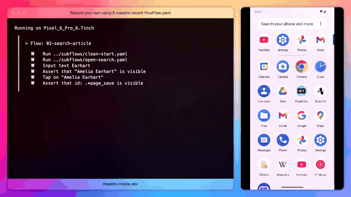
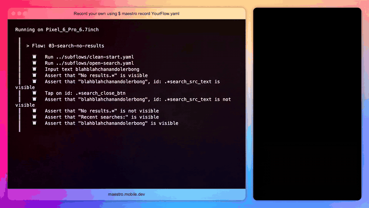
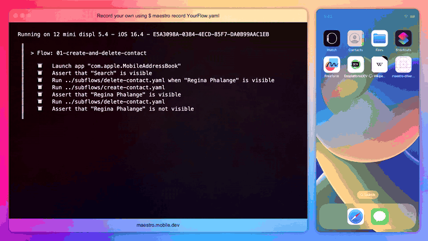

# Mobile E2E tests with Maestro — Android & iOS

End-to-end UI tests written with [Maestro](https://maestro.dev) for two platforms:

- **Android** — the [Wikipedia app](https://github.com/wikimedia/apps-android-wikipedia) (Maestro's sample build), on an emulator
- **iOS** — the built-in **Contacts** app, on an iPhone simulator

A portfolio project: test design, stable selectors, independent and self-cleaning tests, dynamic test data.

## What is covered

### Android — Wikipedia

| # | Test | Type | Tag |
|---|------|------|-----|
| 01 | Onboarding on the first launch | positive | `smoke` |
| 02 | Search for an article and open it | positive | `smoke` |
| 03 | Search with no results, clear the query | negative | `regression` |
| 04 | Save an article, restart the app, find it in Saved | positive, data persistence | `regression` |
| 05 | Community feed: today's date and the Featured article card | positive, dynamic content | `regression` |

### iOS — Contacts

| # | Test | Type | Tag |
|---|------|------|-----|
| 01 | Create a contact, see it in the list, delete it | positive, CRUD | `smoke` |
| 02 | Search finds an existing contact, "No Results" for a missing one | positive + negative | `regression` |
| 03 | New contact form: Done is disabled until a name is entered, Cancel discards | validation, negative | `regression` |

Test cases, priorities, risks and observations: [TEST_PLAN.md](TEST_PLAN.md).

## How the tests are built

- **Independent tests.** On Android every test starts from a clean app state (`clearState`) and goes through onboarding in a shared subflow. Built-in iOS apps cannot be reinstalled, so `clearState` is not available there: the iOS tests clean up after themselves instead, and remove leftovers from a failed previous run before they start.
- **Stable selectors.** Elements are found by id or visible text, never by screen coordinates.
- **No fixed sleeps.** Network content is awaited with `extendedWaitUntil`.
- **Resilient to UI changes.** Onboarding is passed with a `repeat … while` loop, so a different number of intro screens doesn't break the tests; optional dialogs are handled with a conditional `runFlow`.
- **Reusable steps with parameters.** Creating and deleting a contact are subflows that take the contact name via `env`.
- **Dynamic data.** The Wikipedia feed changes every day: the test computes today's date in JavaScript and reads the Featured article title from the screen (`copyTextFrom`) instead of hard-coding it. The title is regex-escaped before it is used as a selector.
- **Platform quirks are handled, not ignored.** On iOS, rows that are not yet on screen report wrong frames, so long forms are scrolled with real swipes before tapping; the keyboard can cover the row you are about to tap. Both are documented in the test plan.

## Project structure

```
android/            # Wikipedia tests
  flows/            #   tests
  subflows/         #   clean start + onboarding, open search
  scripts/          #   JavaScript helpers: today's date, regex escaping
  config.yaml       #   Maestro workspace config
ios/                # Contacts tests
  flows/            #   tests
  subflows/         #   create contact, delete contact (parameterized)
  config.yaml
docs/               # demo recordings
TEST_PLAN.md        # test cases, priorities, risks, observations
```

## How to run

Requirements: [Maestro CLI](https://docs.maestro.dev) 2.x, Java 17+.

### Android

An Android emulator with internet access and the Wikipedia sample build:

```bash
maestro download-samples
adb install maestro-samples/wikipedia.apk   # path printed by the previous command

maestro test android                        # all Android tests
maestro test android --include-tags=smoke   # smoke only
maestro test android/flows/02-search-article.yaml
```

### iOS

Xcode with an iPhone simulator (Contacts is preinstalled, nothing to install):

```bash
open -a Simulator

maestro test ios
maestro test ios/flows/01-create-and-delete-contact.yaml
```

Tested on: Android emulator Pixel 6 Pro (API 33), iPhone 12 mini simulator (iOS 16.4), Maestro CLI 2.12, macOS 13.

## Demo

Recorded with `maestro record`: test steps on the left, the device on the right.

**Android 02 — Search for an article and open it** (also shows the optional promo sheet being closed by a conditional `runFlow`)



**Android 03 — Search with no results, clear the query**



**iOS 01 — Create and delete a contact**



## Author

Gerta — QA Engineer · [GitHub](https://github.com/GBliii)
